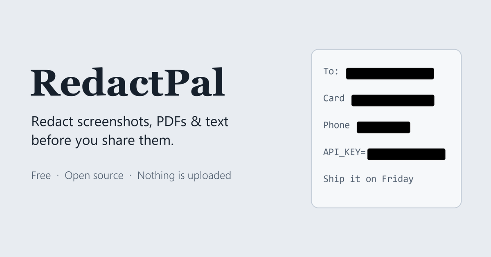

# RedactPal

[](https://redactpal.com)

**[redactpal.com](https://redactpal.com)** · Free · Open source (MIT) · Nothing is uploaded

**Hide sensitive info before you share.** Paste a screenshot, drop a PDF, or paste text — RedactPal finds emails, phone numbers, card numbers, API keys, passwords and more, and covers them with solid boxes. You check, then copy or share the safe version.

Everything runs on your device. Nothing is uploaded. Turn off Wi-Fi and it still works.

## How to use

1. Take a screenshot (or pick an image / PDF).
2. Open RedactPal and press **Ctrl+V / ⌘V** (or drop the file, or tap *Choose*).
3. Sensitive spots are highlighted. Tap a highlight to keep it visible; drag to hide anything that was missed.
4. Press **Copy** (or **Share** on a phone / **Download** for PDFs). The exported file has solid black boxes.

Text works too: paste text to get a redacted copy, or a *placeholder* version to send to an AI chat — then paste the AI's reply back to restore your real values.

## On your phone

Just open the site in your phone's browser — nothing to set up. Tap **Choose a photo or file**, pick a screenshot or PDF, then **Share** the safe version straight to your chat or mail app.

## Install it

Optional, but handy: RedactPal then opens from your home screen like any other app, full screen.

- **Android (Chrome, Edge, Samsung Internet):** tap **Install app** under the start screen (or *Install* in the browser menu). After that, RedactPal appears in your share sheet: in your gallery or files app, tap **Share → RedactPal** on a photo or PDF and it opens ready to check.
- **iPhone / iPad (Safari):** tap **Add to Home Screen** under the start screen for the two steps — the **Share** button, then *Add to Home Screen*.
- **Computer (Chrome, Edge):** the **Install app** link, or the install icon in the address bar.

It works offline after the first time you open it, and updates itself automatically the next time you are online. Installing changes nothing about privacy: your files still never leave the device.

## Why you can trust it

- **No uploads, no tracking, no third-party requests.** All code and the OCR engine are served from the same origin; a strict Content-Security-Policy blocks connections elsewhere.
- **Solid boxes only.** Blur and pixelation can be reversed; RedactPal never uses them.
- **Rebuilt from pixels.** Exported images are re-encoded (no EXIF/GPS). Exported PDFs are rebuilt page-by-page as images, so text under a box cannot be copied out, and metadata (author, title, …) is dropped. Trade-off: text in the exported PDF is not selectable.
- **Detection can miss things.** It is rule-based (formats, checksums, known key prefixes) — always look before you share. Drag over a name once and RedactPal offers to hide it everywhere it appears.

## Self-hosting (companies)

RedactPal is a static site with no backend.

```bash
npm install
npm run build      # outputs dist/
```

Copy `dist/` to any static web server (internal intranet, S3, nginx, GitHub Pages…). That's it.

For the strongest guarantee, also send the Content-Security-Policy as an HTTP header — a `<meta>` CSP (already in the page) does not cover the OCR/PDF web workers. `public/_headers` (Netlify, Cloudflare Pages) and `vercel.json` do this for you; for nginx:

```nginx
add_header Content-Security-Policy "default-src 'self'; script-src 'self' 'wasm-unsafe-eval'; worker-src 'self' blob:; img-src 'self' blob: data:; connect-src 'self' blob: data:; style-src 'self' 'unsafe-inline'; object-src 'none'; base-uri 'none'; form-action 'none'; frame-ancestors 'none'" always;
add_header Referrer-Policy no-referrer always;
```

## Development

```bash
npm install
npm run dev        # http://localhost:5173
npm test           # unit tests (vitest)
```

See [ARCHITECTURE.md](ARCHITECTURE.md) for the module layout and design principles. Landing pages and
guides are Markdown files in `content/` — see [content/README.md](content/README.md).

## License

MIT — free for personal and commercial use.
