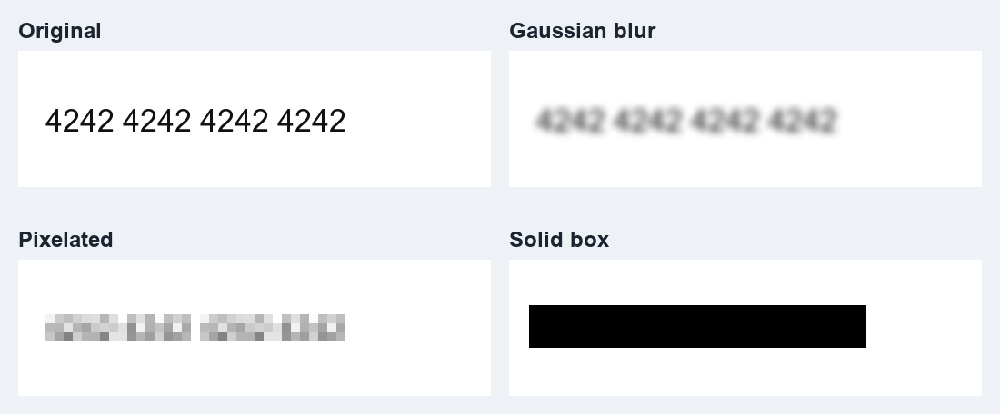

**Often, yes.** Blur and pixelation keep a trace of every letter. When the font and size are known, which is typical for screenshots, researchers have recovered the hidden text. A 2016 study called mosaicing and blurring "not viable" for redaction. To hide text for good, cover it with a solid opaque box and save a flattened copy. [RedactPal](/redact-screenshot/) draws solid boxes for you and never blurs.

## Why blur and pixelation leak information

A blur or a pixelation filter is a fixed calculation. Pixelation replaces each block of pixels with one average color. A blur replaces each pixel with a weighted average of its neighbors. Neither adds randomness, and neither is a one-way function like a hash.

That has a consequence. The same text in the same font, size and position always produces the same blurry result. An attacker who can guess what kind of text is underneath can render candidates, apply the same filter and compare. The closest match wins.

Screenshots make the guessing easy. The font comes from the app or operating system. The size and the colors are visible in the surrounding interface. All that is left to find is the text.

## What the research shows

| When | Who | What they showed |
| --- | --- | --- |
| 2016 | Hill, Zhou, Saul and Shacham | Used hidden Markov models, a technique from speech recognition, to recover text from mosaiced and blurred images. They concluded that these methods "are not viable approaches for text redaction." |
| Feb 2020 | James Fisher | Showed that in a simple blur model the original can be fully solved for, step by step. |
| Jan 2022 | Positive Security | Recovered a pixelated IBAN from a video by stabilizing and overlaying frames. |
| Feb 2022 | Bishop Fox (Dan Petro) | The Unredacter tool guessed text hidden by a pixelation challenge. Jumpsec confirmed the guess was correct. |
| Archived Apr 2026 | Depix | A proof of concept that recovers plaintext from pixelized screenshots. |

Each source in more detail:

- **Hill et al., 2016.** The paper, ["On the (In)effectiveness of Mosaicing and Blurring as Tools for Document Redaction"](https://petsymposium.org/popets/2016/popets-2016-0047.php), appeared in Proceedings on Privacy Enhancing Technologies 2016(4), pages 403 to 417. The authors tested different typefaces, font sizes, grid sizes, pixel offsets and noise levels, and also decoded real-world redacted examples.
- **Fisher, 2020.** In ["When in doubt, don't blur it out"](https://jameshfisher.com/2020/02/29/when-in-doubt-dont-blur-it-out/), Fisher uses a deliberately simple one-dimensional blur to show the idea: each blurred pixel is an average of three source pixels, so you can solve for the originals one by one. He suggests that knowing the source is text in a known font would help further, but doesn't demonstrate it. Read it as a demonstration of the principle, not a measurement of real screenshots.
- **Bishop Fox, 2022.** In [a write-up on pixelation and redaction](https://bishopfox.com/blog/unredacter-tool-never-pixelation) (15 Feb 2022), Dan Petro describes [Unredacter](https://github.com/BishopFox/unredacter). It needs to know the font, the font size and that the hidden content is text. It does not need to know the pixelation offset, because it searches the possibilities. Jumpsec Labs had offered a prize for recovering text from a pixelated image. Petro's tool produced a guess that Jumpsec confirmed. His conclusion: "the only way to do it securely is to use black bars."
- **Positive Security, 2022.** In [a write-up on depixelating video](https://positive.security/blog/video-depixelation) (25 Jan 2022), Fabian Bräunlein shows that pixelation in a video is weaker than in a still image, because every frame is a slightly different sample of the same text. In his own test video, he tracked the camera movement, stabilized the footage and overlaid the aligned frames. A pixelated IBAN became readable enough to recover, with one digit left ambiguous between two values. His recommendation is an opaque box of a single color.
- **Depix.** [Depix](https://github.com/spipm/Depix) is a proof of concept for recovering plaintext from pixelized screenshots. Its GitHub repository was archived on 14 April 2026, and the project moved to [Codeberg](https://codeberg.org/spipm/Depixelization_poc). The README states its limits plainly. It works on pixelation made with a linear box filter, it assumes whole-pixel text positions, and extra image compression breaks it. It also needs the font settings or a matching search image. These limits are real. They are also conditions that many plain screenshots meet.

None of this is a how-to, and we don't give one. The point is narrow: the attacks are published, free and aimed at exactly the kind of image people blur.

## Can AI "unblur" text?

Not in the way the ads suggest. AI upscalers generate plausible detail. They don't read what was there, so their output can look sharp and be wrong.

Positive Security tried four video enhancement tools on its pixelated test footage. TecoGAN, Topaz Video Enhance AI and MFSR gave no readable result, and VideoEnhancer produced an illegible one, according to the write-up. Aligning and overlaying frames worked.

So an AI "unblur" failing tells you little. The attacks that succeed in the literature are matching attacks: they test candidates against the filter. Those need a font, not a neural network.

## When is blurred text actually safe?

Sometimes it is, and that is the problem. A heavy blur on a long, unpredictable string in an unknown font is much harder to attack than a lightly pixelated card number in a system font. But you can't tell which case you are in by looking, and an image you posted stays out there.

The riskiest cases are short or predictable items: PINs, card digits, account numbers, names from a known list, anything with a known format. If a secret matters, don't bet on the blur.

## Blur vs pixelate vs black box vs crop

| Method | What the evidence says | Shows length? | Best for |
| --- | --- | --- | --- |
| Blur | Recovered in published research when the font is known | Yes | Casual use where a guess is acceptable |
| Pixelate | Recovered by Unredacter, Depix and a frame-overlay attack | Yes | Nothing sensitive |
| Solid opaque box | The covered pixels no longer exist in the exported image | Roughly (box width) | Text, numbers, keys, names |
| Crop | Removes the region from the image, if the saved file really drops it | No | Cutting a whole area out |

For crop, check that the tool you use really discards the cropped pixels in the saved file. Our guides on the [Windows Snipping Tool](/guides/snipping-tool-quick-redact-limits/) and [iPhone Markup](/guides/iphone-markup-redaction-safe/) cover two common ones.

## Tools that blur by default

Plenty of everyday tools offer blur or pixelation as the redaction option. A recent example: in September 2026, 9to5Google [reported](https://9to5google.com/2026/09/24/google-photos-redact-moods/) a "Redact" pen in Google Photos for Android that lets you blur or pixelate sensitive info in screenshots and images. The article doesn't mention a black-out option. It is a reasonable convenience for casual use. For anything you would regret leaking, switch to opaque boxes.

## How to hide text so it can't be recovered

1. **Cover it completely** with a solid, fully opaque box. Not translucent, not a highlighter.
2. **Burn it in.** Export a new image so the box becomes part of the pixels, not a layer or annotation someone can remove.
3. **Re-encode the file.** A fresh PNG carries none of the original pixels under the box.
4. **Look at the result** before you share it. Zoom in and check every line.

<!-- cta -->

RedactPal does all four. It only draws solid boxes, never blur or pixelation. Exports are re-encoded as PNG, so there is no EXIF or GPS data, and PDFs are rebuilt page by page from pixels. It runs in your browser with no upload, and the [source is on GitHub](https://github.com/TaoMachina/redactpal). The detector is rule-based: it finds emails, card numbers, IBANs and key formats such as `sk-proj-`, `ghp_` and `AKIA`, and you add anything else with one drag. Check the highlights before you copy.

If you have already posted a blurred secret, rotate it first. Our guide on an [API key leaked in a screenshot](/guides/api-key-leaked-in-screenshot-what-to-do/) has the steps. For a broader look at hiding keys, see [hide API keys in screenshots](/hide-api-keys-in-screenshots/).

*Updated 2026-11-15: rewritten with sources checked against the original papers and write-ups. This guide is general information, not legal advice.*
