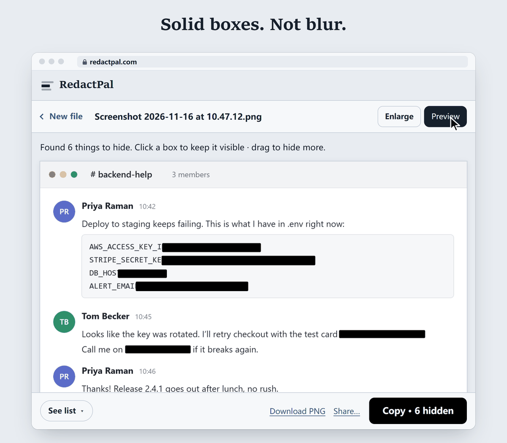

**Snagit's Smart Redact is the one other tool that finds sensitive text in a screenshot for you, and it comes with a paid Snagit license. RedactPal does the same job free in your browser: it auto-detects emails, phone numbers, card numbers, IBANs and API keys, covers them with solid boxes, and never uploads the image.**

Last tested: November 16, 2026 · Chrome on Windows 11 · By [Yuntao Zou](https://yuntaozou.com)

We make RedactPal. We link the source for every claim about Snagit below, and we haven't run Snagit on our own test files, so its details are taken from TechSmith's pages as of November 2026.

## What does Snagit's Smart Redact do?

Smart Redact is part of Snagit, TechSmith's screen-capture and editing app. According to TechSmith's [Smart Redact page](https://www.techsmith.com/snagit/features/smart-redact/), you click **Smart Redact** in the Blur tool's properties panel and Snagit scans the capture for sensitive data. It looks for:

- addresses
- credit card numbers
- dates
- email addresses
- faces
- IP addresses
- phone numbers
- Social Security numbers
- URLs

You can turn each type on or off, adjust the results, and choose how the area is covered: the page names blur, pixelation and black bars. It is a good feature.

## Why look for a free alternative?

Three reasons come up most.

**Price.** Snagit is sold as a yearly subscription for individuals, according to TechSmith's [store page](https://www.techsmith.com/store/snagit), which also lists a 14-day money-back guarantee. TechSmith's [support page](https://support.techsmith.com/hc/en-us/articles/360021040791) describes a fully functional 15-day trial, after which you need a license. If you redact a screenshot once a month, that is a lot of software for one button.

**A desktop install.** The store page lists Windows 10 and 11 and macOS 14 or later. If you are on a work laptop that blocks installs, on Linux, on a Chromebook or on a phone, the store page lists no version for you. RedactPal runs in any modern browser, installs as an app if you want one, and is just static files you can host yourself.

**Where the image goes.** TechSmith's Smart Redact page doesn't say whether detection runs on your device, so we don't claim either way. RedactPal answers the question in a way you can test: nothing is uploaded, and the [Network-tab test](/guides/how-to-check-a-redaction-tool-doesnt-upload-your-file/) takes a minute.

## What does RedactPal do instead?

[RedactPal](/redact-screenshot/) is free with no limits, no account, no ads and no tracking. It is open source (MIT), a public-good project rather than a trial for a paid plan.

Paste or drop a screenshot and RedactPal reads the text on your device with OCR, then matches it against rules: known formats, checksums and key prefixes. It highlights what it finds, and you check every box before anything is shared.

. Six items are highlighted automatically. Click a box to keep it visible, or drag to hide more.")

When you click **Preview**, every highlight becomes a solid black box:

What RedactPal finds automatically:

- email addresses and phone numbers
- credit card numbers (Luhn-checked) and IBANs (mod-97-checked)
- labelled bank account numbers, US routing numbers and UK sort codes
- US Social Security numbers, IP and MAC addresses
- passwords and secrets in config text, JWTs, `Authorization` headers and private keys
- API keys for AWS, GitHub, GitLab, Slack, Stripe, OpenAI, Anthropic, Google and more

The full list is in [`src/detect/rules.ts`](https://github.com/TaoMachina/redactpal/blob/main/src/detect/rules.ts). Detection is rule-based, not AI. That is why a card number is only boxed when its checksum passes, and why the output is the same every time you run it.

## Where does each tool win?

| | Snagit Smart Redact | RedactPal |
| --- | --- | --- |
| Price | Part of Snagit, a yearly subscription with a 15-day trial (TechSmith) | Free, no limits |
| Account | A subscription is activated by signing in to a TechSmith account (TechSmith support) | None |
| Where it runs | Desktop app for Windows and macOS (TechSmith) | Any modern browser, installable, self-hostable |
| Upload | Not stated on TechSmith's Smart Redact page | Nothing is uploaded. Check it yourself in the Network tab |
| Emails, phone numbers, card numbers | Yes | Yes (cards Luhn-checked) |
| IBANs, bank account and routing numbers | Not on its list | Yes |
| API keys, JWTs, passwords, private keys | Not on its list | Yes |
| Faces | Yes | No: drag a box |
| Addresses and dates | Yes | No auto-detect: drag a box once, and every match is offered |
| How the area is covered | Blur, pixelation or black bars | Solid boxes only |
| Capture, annotations, video | Yes, it is a full capture suite | No: it redacts, nothing else |
| Open source | No | Yes, MIT |

Snagit's strength is breadth. If you capture and annotate screens all day and want faces, addresses and dates found automatically, Smart Redact earns its place in that workflow. If your job is "hide the keys, cards and emails in this screenshot before I post it", RedactPal does it for nothing and keeps the image on your device.

## Why do solid boxes matter?

Blur and pixelation keep a trace of every letter, and researchers have recovered text from them when the font is known. [A 2016 study](https://petsymposium.org/popets/2016/popets-2016-0047.php) called mosaicing and blurring "not viable" for redaction. That is why RedactPal only draws opaque boxes and re-encodes the image, so nothing of the original pixels remains under a box. If you do use blur anywhere, read [can blurred text be unblurred](/guides/can-blurred-text-be-unblurred/) first, and prefer black bars.

## How do you redact a screenshot with RedactPal?

1. **Paste or drop the screenshot** on [redactpal.com](/redact-screenshot/). Press Ctrl+V / ⌘V, or tap **Choose a photo or PDF** on a phone.
2. **Check the highlights.** Tap one to keep it visible.
3. **Drag over anything else**, such as a face, a name or an address. RedactPal offers to hide the same text everywhere it appears.
4. **Copy, share or save.** The result is a fresh PNG with solid boxes.

Developers leaking a `.env` or a terminal can go straight to [hiding API keys in screenshots](/hide-api-keys-in-screenshots/). If a key has already been posted, [rotate it first](/guides/api-key-leaked-in-screenshot-what-to-do/).

## Which one fits your situation?

- **You post a screenshot of a terminal, `.env` file or dashboard in an issue or chat.** The risk is keys, tokens, IPs and emails. RedactPal's detector is built for exactly these, and the box is solid. Use it, then [rotate any key that already leaked](/guides/api-key-leaked-in-screenshot-what-to-do/).
- **You send a bank or payment screenshot.** Card numbers, IBANs, account and routing numbers are all found. Names and addresses you cover with one drag. See [redacting a bank statement](/redact-bank-statement/).
- **You publish tutorials with photos of people or street signs.** Faces are Smart Redact's territory. RedactPal won't find a face for you, so if faces are the job, Snagit fits better.
- **You write documentation with annotated captures every day.** Snagit is a capture and editing suite, and redaction is one tool in it. RedactPal is the quick, free step you run before you share.
- **You are on a managed laptop, a Chromebook or a phone.** A browser tool needs no install and no admin rights.

If you aren't sure whether a screenshot is safe to share, run it through RedactPal first and check the preview. It costs a minute, and nothing leaves your device.

<!-- cta -->

## The verdict

If you already pay for Snagit, use Smart Redact, check every box, and prefer black bars over blur. If you don't, you don't need to buy it for redaction. RedactPal finds the secrets developers and everyday users leak most, hides them with solid boxes, and keeps your screenshot on your device. It is free, and you can verify the privacy claim yourself in a minute.

Snagit and TechSmith are trademarks of TechSmith Corporation. RedactPal is not affiliated with TechSmith. Details about Snagit come from TechSmith's own pages as of November 2026 and may change.
